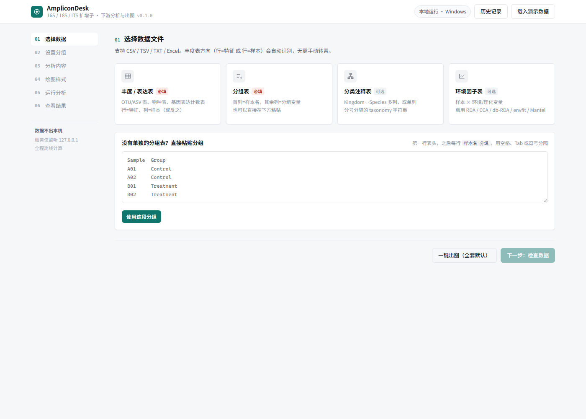

# AmpliconDesk · 16S 扩增子下游分析与出图

一个**专注 16S 扩增子**的下游分析与出图工具。把「OTU/ASV 丰度表 + 分组表（+ 可选环境因子表）」交给它，
**一键**完成多样性、排序、多元统计检验、差异分析、机器学习与高级可视化，
产出 **60 张可直接投稿的图**和一份自包含 HTML 报告，并自动写出中文结论。



- **纯 Python，零联网**，数据不出本机
- **强制要求分组表**：没有分组就没有组间比较，分析顺序是先组间差异、再组内差异
- **自动识别**表格方向（行是特征还是样本）、数据构成（原始计数还是相对丰度）、文件格式
- **可视化样式全可调**：22 套科研配色、任意本地字体、线条与边框、PNG+PDF 输出
- **自动生成中文结论**：直接写出"谁和谁相比差异是否显著、用了什么检验、为什么用它"
- **单文件目录**：内置 Python 运行时，复制整个 `AmpliconDesk` 文件夹到任何 64 位 Windows 电脑，双击即用

> 本工具**只做 16S/18S/ITS 扩增子**的下游分析与出图。宏转录组专属的文库归一化（TMM / DESeq2）、负二项差异表达检验与功能富集（GO/KEGG）已从界面与流程中移除。

---

## 一、快速开始

### 就一步

双击文件夹里的 **`启动.bat`**，浏览器会自动打开 `http://127.0.0.1:8765/`。

脚本会优先使用本文件夹内置的 Python（`runtime\python.exe`）；
如果没有内置运行时，则回退到系统已安装的 Python。两种情况都不需要联网。

```bat
启动.bat                  :: 双击即可
runtime\python.exe run.py --port 9000 --no-browser   :: 想手动指定端口/不开浏览器
```

### 从 GitHub 源码运行

公开仓库只包含源码和演示数据，不包含约 750 MB 的内置 Python 运行时。请先安装
Python 3.10+，然后在项目目录执行：

```bat
python -m venv .venv
.venv\Scripts\python -m pip install -r requirements.txt
.venv\Scripts\python run.py
```

也可以在 macOS / Linux 上运行：

```bash
python3 -m venv .venv
source .venv/bin/activate
python -m pip install -r requirements.txt
python run.py
```

### 六步出结果（也可以一步）

| 步骤 | 做什么 |
| --- | --- |
| ① 选择数据 | 拖入丰度表、分组表；可选分类注释表 / 环境因子表。**「⚡ 一键出图」可直接用全量默认设置跑完** |
| ② 设置分组 | 自动识别分组列、显示每组样本数、勾选比较组 |
| ③ 分析内容 | 5 个快捷预设（精简 / 标准 / 全量 / 侧重差异 / 侧重排序）+ 模块级微调 |
| ④ 绘图样式 | 字体、字号、斜体加粗、线条、边框、**22 套科研配色**，右侧实时预览 |
| ⑤ 运行分析 | 实时进度与日志 |
| ⑥ 查看结果 | **自动结论** + 统计卡片 + 图集（按分区筛选、单图下载 PNG/PDF） |


### 先试一下

右上角 **「载入演示数据」** → 四套演示数据任选 → 直接点「开始分析」。

---

## 二、输入格式

### 支持的文件格式（丰度表与分组表均支持）

`.xlsx` · `.xls` · `.csv` · `.tsv` · `.txt`

分隔符自动嗅探（逗号 / 制表符 / 分号 / 竖线），编码自动适配（UTF-8 / GB18030 / Latin-1）。

### OTU / ASV 丰度表（必填）

- 行 = OTU/ASV，列 = 样本 —— **或反过来，程序自动识别并转置**
- **自动判断是原始计数还是相对丰度**：
  - 列和 ≈ 1 → 相对丰度（比例）
  - 列和 ≈ 100 → 相对丰度（百分比），自动归一化到 0~1
  - 取值基本为整数 → 原始计数
  - 判定结果写入报告，并在不合适时给出提示（例如相对丰度表不推荐抽平与 Chao1）

### 分组表（必填）

行 = 样本，第一列是样本名；其余列是分组变量（可多列，运行时选择用哪一列）。
样本名匹配**忽略大小写、空格、下划线、连字符**。

没有单独的分组表？在界面里直接粘贴「样本名 + 分组」两列即可。

### 环境 / 协变量表（可选）

样本 × 环境或理化变量（数值、分类均可）。启用 **RDA / CCA / db-RDA / envfit / Mantel**。
不提供时，程序用分组变量自动构造约束因子，保证这些分析仍可运行。

### 分类注释表（可选）

OTU/ASV → Kingdom…Species 八级分类，用于按门/纲/目/科/属/种聚合的组成图与热图。
两种格式任选：多列分级表，或单列分号分隔的 taxonomy 字符串。

---

## 三、分析内容

分析顺序刻意安排为**先组间、后组内**：先确认分组之间有没有差异，再确认每组内部是否一致，避免把组内异质性误读成组间差异。

全部模块勾选时共 **60 张图**。

### 测序深度（3 图）
稀释曲线、物种累积曲线、等级丰度曲线。

### Alpha 多样性（4 图）
Observed / Chao1 / Shannon / Simpson / InvSimpson / Pielou / Goods coverage / 文库大小。
箱线图（含散点与检验标注）、Z-score 热图、Alpha 稀释曲线（分组均值 ± 标准差）、**样本质控概览**（自动标注离群样本）。

### 组间差异（4 图 + 6 项检验）
- 四种距离：**Bray-Curtis**、**Jaccard**、**Aitchison（CLR 欧氏）**、**Euclidean**
- **组间 vs 组内距离对比图**（一眼看出分组是否成立）
- 组内/组间距离箱线图
- **PERMANOVA**（R²、伪 F、置换 p）、**ANOSIM**、**MRPP**（δ、A、p）、**PERMDISP**（离散度齐性）
- 多分组时自动两两比较 + BH 校正

### 多元统计检验（最多 6 图）
**PERMDISP** 距离分布图、**Mantel** 检验、**envfit** 因子拟合、**Procrustes** 一致性分析。

> **PERMDISP 很关键**：它告诉你组间差异是"质心不同"还是"离散度不同"。结论里会明确写出这一点。

### 排序分析（最多 15 图）
PCoA（每距离一张 + 碎石图）、NMDS、PCA（含载荷 biplot 箭头）、t-SNE、UMAP、
PLS-DA（含交叉验证准确率 + **VIP 图**）、RDA、db-RDA、CCA、CAP。

### 组内差异（3 图）
- **组内异质性分析**：各组内部两两距离分布 + 组内距离变异系数（CV）
- **组内多样性一致性**：每个组内 alpha 指标的离散程度
- **分组总览**：样本数、文库大小、组内距离、组内 Shannon 四联图

### 群落组成（6 图）
按任意分类级或按特征：堆叠柱状图、面积图、层次聚类热图、优势类群箱线图、
**Venn / UpSet 共享特征图**、**核心微生物组分析**。三组数据时额外输出**三元图**。

### 差异分析（每比较组 8 图）
**CLR 中心化对数比空间**的 Mann-Whitney U 检验（Wilcoxon 秩和），适合稀疏、组成型的扩增子数据。
输出 **log2FC、lfcSE、p、BH-FDR、Cliff's delta 效应量**；
火山图、MA 图、log2FC 条形图、森林图（含 95% CI）、差异特征箱线图、差异特征热图、LEfSe 风格 LDA。

### 机器学习（3 图）
随机森林分层交叉验证准确率、ROC/AUC、基尼特征重要性、混淆矩阵。

### 高级图形（最多 8 图）
**小提琴图**、**云雨图 / 半箱线小提琴云雨图**、**密度图**、**蜂群图**、
**棒棒糖图**、**气泡图**、**桑基图**（分类级流向）、**分组→类群流向图**、**维诺树状图**。

---

## 四、统计检验体系

### 内置的完整检验链

| 环节 | 方法 |
| --- | --- |
| **正态性** | Shapiro-Wilk（默认）、D'Agostino、Anderson-Darling、Kolmogorov-Smirnov |
| **方差齐性** | Levene（默认，稳健）、Bartlett（要求正态）、Fligner |
| **两组比较** | Student t、Welch t、配对 t、Wilcoxon 秩和（Mann-Whitney U）、Wilcoxon 符号秩 |
| **多组比较** | 单因素 ANOVA + **Tukey HSD**、Kruskal-Wallis + **Dunn 事后检验** |
| **分类变量** | 卡方（2×2 自动 Yates 校正）、**Fisher 精确检验**（期望频数过小时自动切换） |
| **效应量** | Cohen's d、Hedges' g、Cliff's delta、rank-biserial、Cramér's V、η²、ε² |

### 自动选择逻辑

程序会先查**正态性**和**方差齐性**，再自动挑方法，并把**选择理由**写进结果和结论：

> 数据经 Shapiro-Wilk 检验不符合正态分布（p = 0.003），因此采用 Mann-Whitney U 检验。
>
> 各组数据均符合正态分布（p > 0.05）且方差齐性（Levene p = 0.21），采用单因素方差分析（ANOVA），事后检验用 Tukey HSD。

也可以在界面上手动指定检验方法。全部结果写入 `tables/hypothesis_tests.csv`：
含分析范围、变量、组数、检验方法、统计量、p、显著性、效应量、**是否自动选择**、**选择理由**。

---

## 五、自动结论描述

每次运行都会生成 `结论描述.md` 与 `conclusions.txt`，并在界面和报告顶部展示。结论完全由实际统计数值驱动，例如：

> **综合结果表明**：4 项 Alpha 多样性指标存在组间显著差异；2 种距离指标下群落结构存在显著组间差异；随机森林以 100% 的准确率成功区分分组。
>
> **【Beta 多样性】** 基于 Bray-Curtis 距离的 PERMANOVA 检验表明，分组对群落结构有显著影响（R² = 0.859，F = 134.12，p = 0.003\*\*），即分组因素可解释约 85.9% 的组间变异。
> - ANOSIM 结果一致（R = 1.000，p = 0.003）。
> - MRPP 检验支持组间差异（组内一致度 A = 0.568，p = 0.003）。
> - PERMDISP 检验显示各组离散度齐性（F = 0.75，p = 0.383），因此上述组间差异可以较有把握地归因于群落组成本身的差异。
>
> **【差异分析】** 在 Control 与 Treatment 的差异分析中共检出 42 个差异显著特征（FDR < 0.05 且 |log2FC| ≥ 1），其中在 Control 中富集 22 个、在 Treatment 中富集 20 个。
> - OTU_0001：log2FC = -3.98，p < 0.001，FDR < 0.001（在 Treatment 中富集）

显著的结论、不显著的结论都会写出来（避免只报阳性结果）。界面上一键复制全文。

---

## 六、绘图样式系统

**113 个可调项**，界面按 schema 自动生成控件，右侧实时预览（25 种图可选）。

### 字体
- **默认 Times New Roman**，自动附带中文字体回退（不会出现方块）
- 可任意选择**本机已装字体**；总标题 / 子图标题 / 坐标轴标签 / 刻度 / 图例 / 标注**每一项都能单独指定字体**
- 每一项都能单独设 **加粗** 与 **斜体**
- 字号整体缩放，或逐项设字号
- 标题 / 轴标签 / 图例等**每一项都能设水平与垂直偏移**（单位：磅），用来微调摆放位置
- 每项文字都可以**覆盖成自定义内容**

### 线条与边框
| 项 | 说明 |
| --- | --- |
| 边框显示 | 整体开关；关闭后不画任何轴线 |
| 四周边框完整闭合 | 关闭则只保留左边和下边（常见的"半开放"样式） |
| 边框颜色 / 线宽 | 单独可调 |
| 数据线宽 | 曲线、折线、误差棒的统一线宽 |
| 网格线宽 / 透明度 / 颜色 | 可调 |
| 刻度线宽 / 长度 / 方向 | 可调（in / out / inout） |

### 配色
- **22 套科研配色方案**（来自你的配色方案表，重复色已自动去重）
- **整套使用**：一键把某套方案应用到全部分组
- **任选若干色**：点色块多选 → "使用选中的 N 种颜色"，按顺序分配给各分组
- 还能**逐分组指定颜色**（颜色选择器）
- 另有 10 套内置调色板（Okabe-Ito 色盲友好、Nature、NEJM、Lancet、JCO 等）
- 连续型 / 双向 / 热图色图分别可选

### 元素与图例
网格、零轴参考线、置信椭圆（开关 + 透明度 + 标准差倍数）、散点大小 / 透明度 / 描边 /
**显示样本名**、抖动幅度、箱体宽度、柱体描边、聚类树、热图数值、X 轴标签旋转、
显著性阈值、标注上限、火山图 log2FC 阈值。

图例默认显示，位置（含"轴外右侧 / 下方"）、列数、边框、标记大小、标题都可调。

### 输出
- **默认同时输出 PNG + PDF**（PDF 为矢量图，文字保持可编辑，可在 Illustrator 中继续加工；只想留一种可在设置里切换）
- **默认 300 ppi**，可选 150 / 200 / 400 / 600
- 可设透明背景

### 逐图覆盖
把「编辑范围」切到某一张图，之后的修改**只影响这张图**，其余图沿用全局设置。
被覆盖的项会显示「单图」标记，可一键清除。

样式可**保存为命名主题**（`themes/*.json`）复用，也会写进 `result.json` 保证结果可复现。

---

## 七、输出

```
output/<run_id>/
├── report.html              ← 自包含报告（图片内嵌，含自动结论与统计表）
├── 结论描述.md              ← 自动生成的中文结论（Markdown）
├── conclusions.txt          ← 同上，纯文本
├── result.json              ← 结构化结果（含完整样式设置）
├── figures/                 ← 300~600 dpi 原图 + 同名 PDF
└── tables/
    ├── analysis_summary.xlsx      全部结果表的 Excel 汇总
    ├── hypothesis_tests.csv       完整假设检验（含方法选择理由）
    ├── within_group_distance.csv  各组组内距离与变异系数
    ├── alpha_diversity.csv / alpha_tests.csv
    ├── distance_*.csv / pairwise_permanova_*.csv / pairwise_mrpp_*.csv
    ├── mantel_*.csv / envfit.csv
    ├── diff_*.csv / lda_*.csv
    ├── composition_relative.csv / composition_table.csv
    ├── size_factors.csv / sample_correlation.csv / expression_pca.csv
        └── rf_importance.csv
```

报告结构：**分析结论** → 数据概览 → **统计检验汇总表** → 各分区图集（带图注）→ 样式设置 → 结果文件清单 → 运行日志。

---

## 八、命令行 / 二次开发

```python
from amplicondesk import run_analysis

result = run_analysis(
    {
        "analysis_type": "amplicon16s",       # 固定值：本工具只做 16S 扩增子
        "abundance_path": "data/otu_table.xlsx",   # xlsx/xls/csv/tsv/txt 均可
        "metadata_path": "data/metadata.csv",      # 必填
        "taxonomy_path": "data/taxonomy.tsv",      # 可选
        "env_path": "data/env.csv",                # 可选，启用 RDA/CCA/envfit/Mantel
        "group_column": "Group",
        "compare_pairs": [["Control", "Treatment"]],
        "rarefy": True,
        "ordinations": ["pcoa", "nmds", "pca", "tsne", "umap", "plsda",
                        "rda", "dbrda", "cca", "cap"],
        "stats_tests": ["permanova", "anosim", "mrpp", "permdisp", "mantel", "envfit"],
        "run_hypothesis": True,     # 完整假设检验 + 自动选择方法
        "run_within_group": True,   # 组内差异分析
        "run_advanced": True,       # 小提琴/云雨/密度/蜂群/棒棒糖/气泡/桑基/维诺
        "permutations": 999,
        "style": {"values": {
            "font.family": "Times New Roman",
            "font.title.style": "italic",
            "font.title.weight": "bold",
            "palette.preset": "科研配色16",
            "palette.custom": ["#5271AE", "#F5CC7D", "#D85B59"],
            "element.frame": False,
            "element.axes_linewidth": 1.2,
            "element.line_width": 2.2,
            "element.frame_color": "#B22222",
            "export.formats": "png+pdf",
            "figure.dpi": 300,
        }},
    },
    output_root="output",
)
print(result["report"])
print(result["narrative"]["headline"])
```

服务端：

```bat
python run.py --no-browser --port 8765
```

### 目录结构

整个工具就是一个自包含文件夹，复制走就能用：

```
AmpliconDesk/
├── 启动.bat / start.bat    ← 双击这个启动（优先用内置 Python）
├── 使用说明.txt            ← 给最终用户看的简明说明
├── README.md               ← 本文件（完整文档）
├── run.py                  ← 启动入口
├── requirements.txt
├── amplicondesk/           ← 程序本体
│   ├── core/
│   │   ├── io.py            表格读取（5 种格式）、方向识别、样本匹配
│   │   ├── preprocess.py    过滤、抽平、相对丰度识别与转换、CLR、分类级聚合
│   │   ├── diversity.py     alpha 指数、距离矩阵、PCoA/NMDS、PERMANOVA/ANOSIM
│   │   ├── hypothesis.py    正态性/方差齐性/t/Wilcoxon/ANOVA+Tukey/KW+Dunn/卡方/Fisher + 自动选择
│   │   ├── ordination.py    PCA / RDA / db-RDA / CCA / CAP / t-SNE / UMAP / PLS-DA
│   │   ├── multivariate.py  MRPP / PERMDISP / Mantel / envfit / Procrustes
│   │   ├── stats.py         BH-FDR、差异丰度、LDA 效应量、随机森林/ROC/混淆矩阵
│   │   └── pipeline.py      全流程编排
│   ├── style.py             样式 schema（113 项）、Style 类、预设主题、科研配色
│   ├── data/
│   │   └── research_palettes.json   22 套科研配色（由你的 Excel 导入）
│   ├── plots/               绘图包：base / alpha / ordination / composition /
│   │                        differential / machine / expression / grouping /
│   │                        advanced / treemap
│   ├── narrative.py         自动中文结论生成器
│   ├── report.py            HTML 报告生成
│   └── web/                 Flask 后端 + 样式实时预览 + 单页前端
├── runtime/                ← 内置 Python 3.14.5 + 全部依赖（不要删）
├── examples/demo_data/     ← 演示数据（3 套）
├── tools/                  ← 自检与维护脚本
├── themes/                 ← 保存的绘图样式主题
├── uploads/                ← 上传的数据缓存
├── output/                 ← 分析结果生成在这里
└── preview/                ← 样式实时预览的缓存图
```

### 主要 API

| 方法 | 路径 | 说明 |
| --- | --- | --- |
| GET | `/api/config` | 分析类型、样式 schema、科研配色、可预览图列表 |
| GET | `/api/fonts` | 系统可用字体（中文字体优先） |
| POST | `/api/upload` | 上传数据文件 |
| POST | `/api/metadata/from_text` | 把粘贴的分组内容转成分组表 |
| POST | `/api/inspect` | 数据体检（方向、样本匹配、分组列候选、相对丰度判定） |
| POST | `/api/style/preview` | 按给定样式实时渲染单张图（带缓存） |
| GET/POST | `/api/style/themes`、`/api/style/save` | 主题列表 / 保存主题 |
| POST | `/api/run` | 提交分析任务 |
| GET | `/api/job/<id>` | 任务进度与结果（含自动结论） |
| GET | `/api/runs` | 历史运行列表 |

---

## 九、自检

所有自检脚本都在 `tools/` 下，用内置 Python 或系统 Python 跑都可以：

```bat
runtime\python.exe tools\make_demo_data.py    :: 生成 16S 演示数据
runtime\python.exe tools\verify_portable.py   :: 便携版验收（跑一次真实分析，8 项检查）
runtime\python.exe tools\quicktest.py         :: 全量模块回归（3 个用例，全量 60 图）
runtime\python.exe tools\selftest.py          :: 端到端跑通并校验产物
runtime\python.exe tools\check_clipping.py    :: 检查每张图是否被裁切（内容贴边）
runtime\python.exe tools\check_frontend.py    :: 前端 id / 样式一致性检查
runtime\python.exe tools\test_abundance.py    :: 相对丰度自动识别测试
runtime\python.exe tools\test_preview.py      :: 样式预览接口回归（25 个图种，需先启动服务）
node tools\screenshot_ui.js                   :: 自动走完整流程并逐屏截图（需先启动服务）
runtime\python.exe tools\test_voronoi.py      :: 维诺树状图收敛性与耗时测试
runtime\python.exe tools\import_palettes.py 科研配色方案.xlsx   :: 从 Excel 重新导入科研配色
runtime\python.exe amplicondesk\core\hypothesis.py   :: 统计检验自检（20 项，含第一类错误率与 CI 覆盖率）
runtime\python.exe amplicondesk\plots\advanced.py    :: 高级图形自检
```

### 重新打包内置运行时

如果你在本机升级了依赖，想把运行时重新打一遍：

```bat
runtime\python.exe tools\rebuild_runtime.py           :: 复制本机已装好的依赖（推荐）
runtime\python.exe tools\rebuild_runtime.py --pip     :: 改为在线 pip 安装
runtime\python.exe tools\rebuild_runtime.py --verify  :: 重建后再跑一次验收
```

> 之所以默认「复制本机依赖」而不是 `pip install`：Windows 的 **Smart App Control** 会拦截新下载的
> 未签名扩展模块（报错"应用程序控制策略已阻止此文件"），而本机已安装并正常运行的依赖是被放行的。

---

## 十、常见问题

**Q：中文字体显示成方块？**
不会。程序在指定字体（如 Times New Roman）后面自动挂上中文字体回退链，中英文混排正常。
也可以在「绘图样式 → 全局 → 全局字体」里改成纯中文字体。

**Q：Smart App Control 拦截未签名的扩展模块？**
Windows 的 Smart App Control 会拦截新下载的未签名 `.pyd`（报错"应用程序控制策略已阻止此文件"）。
`tools/rebuild_runtime.py` 默认改为**复制本机已通过策略的依赖**，并在构建结束时执行 `Unblock-File`，
因此本机与目标机都能正常加载。若目标机也开了 Smart App Control，可在文件夹上添加信任，
或临时关闭该功能。

**Q：样本名对不上怎么办？**
第②步的「数据检查」会明确列出哪些样本只在丰度表里、哪些只在分组表里，按交集分析。

**Q：怎么只画我想要的图？**
默认一键跑全量（60 图），然后在结果页按分区筛选浏览，每张图都能单独下载 PNG / PDF。
如果一开始就不想要某些模块，用「快捷预设」或取消对应模块即可，不需要逐张勾选。

**Q：为什么先看组间再看组内？**
如果组内样本本身就散得很开，组间差异的解读就要打折扣。所以程序把「组间差异」放在前面、
「组内差异」放在后面，并在结论里直接写明组内异质性的影响。

**Q：能跑多大？**
16S 的 OTU/ASV 表（几千特征 × 几百样本）毫无压力。上传上限 512 MB。

**Q：要不要联网？**
不需要。服务只监听 `127.0.0.1`，全部计算在本机完成，数据不外传。

---

## 十一、依赖

本工具所在文件夹**已自带 Python 3.14.5 与全部依赖**，目标机器不需要安装任何东西。

如果想在别的 Python 环境里跑（Python ≥ 3.10，已在 3.14.5 / Windows 上验证）：

```
flask  pandas  numpy  scipy  scikit-learn  seaborn  matplotlib  openpyxl  xlrd
umap-learn        # UMAP 降维
matplotlib-venn   # Venn 图
```

```bat
python -m pip install -r requirements.txt
python run.py
```

内置运行时：Python 3.14.5 嵌入式解释器 + 全部依赖，**不需要目标机安装任何东西**。

---

## 十二、开源许可证

本项目采用 [MIT License](LICENSE) 开源。你可以自由使用、修改、分发和商业使用，
请保留许可证与版权声明。
